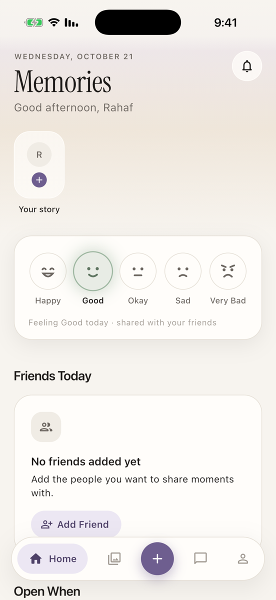
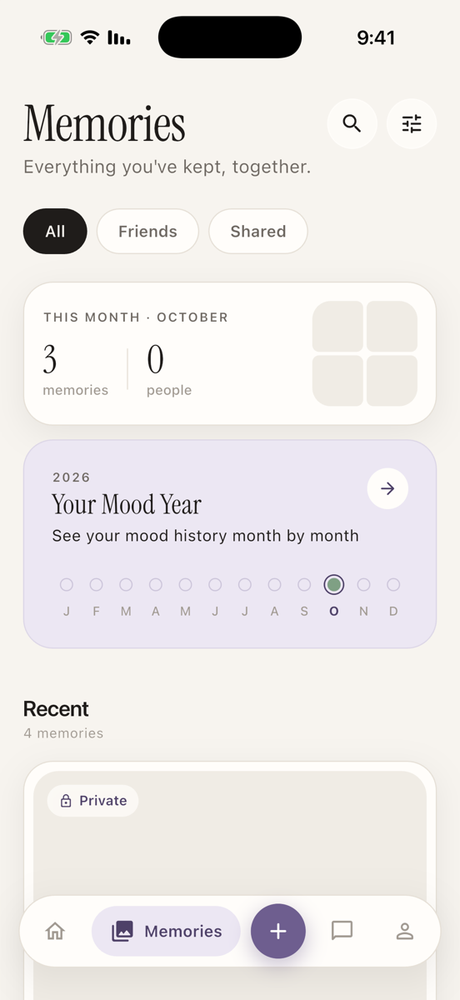
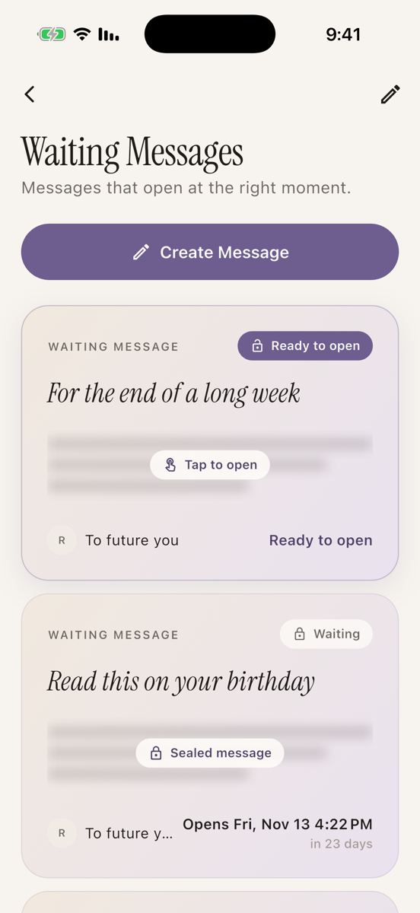
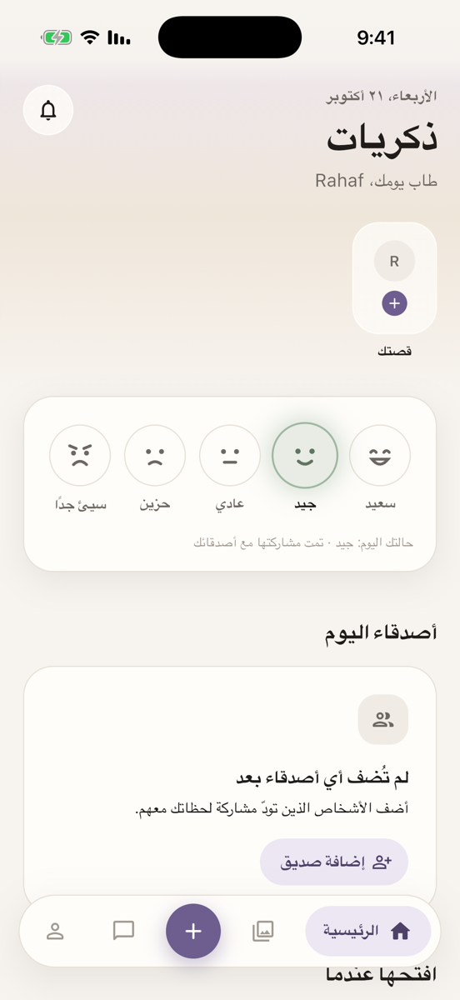

# Memories

A private mobile app for keeping the moments that matter: photo memories, daily moods, and messages that stay sealed until the day they're meant to be opened.

Built with **Flutter** and **Supabase**, in **English and Arabic** with full right-to-left support.

<p align="center">
  
  &nbsp;
  
  &nbsp;
  
  &nbsp;
  
</p>

## Features

- **Memories:** save a moment with a title, story, date and photo. Photos live in private storage and are shown through short-lived signed URLs.
- **Waiting Messages:** write a message to your future self that unlocks at a chosen date and time. Each message goes from *waiting* to *ready to open* to *opened*, with an opening animation the first time it's read.
- **Daily mood:** check in with line-drawn mood faces and see a year of moods at a glance.
- **Accounts:** email and password sign-up with email confirmation. Each user can only access their own data.
- **Friends and chat:** add friends and keep conversations, with reactions and unread state.
- **Two languages:** English and العربية, switchable in Settings, with the whole layout mirrored for Arabic.

## Technologies

| | |
| --- | --- |
| **Flutter / Dart** | Cross-platform UI (iOS and Android), Dart 3 |
| **Supabase** | Backend as a service |
| **Authentication** | Supabase Auth: email and password, email confirmation, session handling |
| **Database** | Supabase Postgres with Row Level Security (`user_id = auth.uid()`) |
| **Storage** | Private bucket with per-user folders and signed URLs |
| **Localization** | Flutter `gen-l10n` (ARB files), RTL layout |
| **Testing** | `flutter_test`: unit and widget tests |

## Architecture

The UI never talks to the backend directly:

```
Screens & widgets  →  Services  →  Repository interfaces
                                     ├── Supabase implementations (app)
                                     └── In-memory implementations (tests / offline)
```

- **Repositories** describe the data the app needs, and the Supabase and in-memory versions are interchangeable.
- **Services** hold the app logic, for example uploading a photo before a memory is saved and removing it if the save fails, or deciding when a message becomes ready to open.
- **One composition root** (`AppDependencies`) wires everything together, so screens can be tested without a network.
- **An injectable clock** makes time-based behaviour, such as messages unlocking, testable.

## Project structure

```
lib/
├── app/            App setup, navigation, auth gate, dependency wiring
├── core/           Theme (colors, typography, spacing), config, utilities
├── data/
│   ├── repositories/   Repository interfaces
│   ├── supabase/       Supabase implementations and row mapping
│   └── mock/           In-memory implementations for tests and offline use
├── l10n/           English and Arabic translations
├── models/         Data models (Memory, ScheduledLetter, Mood, …)
├── screens/        One folder per feature
├── services/       App logic used by the screens
└── widgets/        Reusable UI components
test/               Unit and widget tests
```

## Running locally

**Requirements:** Flutter SDK (Dart 3.13+), Xcode or Android Studio, and a Supabase project.

```bash
flutter pub get
cp env.example.json env.json   # add your Supabase URL and publishable key
flutter run --dart-define-from-file=env.json
```

`env.json` is git-ignored. Only use the **publishable** key in the app. It refuses to start with a secret or `service_role` key.

**Supabase setup:**
- `public.memorise` table for memories (`user_id`, `title`, `description`, `memory_date`, `mood`, `image_url`)
- `public.open_when` table for scheduled messages (`kind`, `recipient_name`, `title`, `body`, `image_url`, `open_at`, `status`, `opened_at`, `note`)
- Private storage bucket `memory-photos`, where users can only access the folder named after their user id
- Row Level Security on both tables, so users only see rows where `user_id = auth.uid()`

**Checks:**

```bash
flutter analyze
flutter test
```

## Roadmap

- Enforce message unlock times on the server
- Friends as real accounts, with messages delivered between users
- Realtime chat with Supabase Realtime
